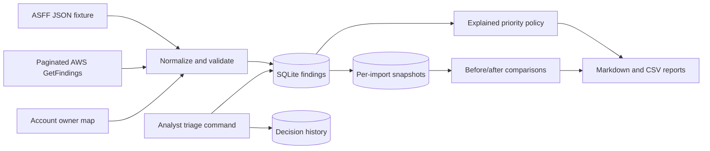

# Design decisions

## Data flow

## Decisions and trade-offs

| Choice | Reason | Limitation |
| --- | --- | --- |
| SQLite and a CLI | Easy to inspect and run; enough for one analyst | No shared UI, access controls, or multi-user service |
| Product ARN + finding ID | Stable source identity prevents false merges by title | Related findings from different products stay separate |
| Source UpdatedAt orders evidence | Ignore late stale updates | Assumes trustworthy provider timestamps; equal timestamps accept the last payload |
| Preserve local triage on ingestion | Analyst work survives repeated reports | Changed exceptions need a separate effective state |
| Require exception expiry | Accepted risk remains reviewable | No real organizational approval workflow |
| Re-review any changed source timestamp | Prevent silently suppressing updated evidence | Harmless source refreshes can also trigger review |
| Read all provider statuses | Local inventory learns about resolutions and archives | Higher API volume than an incremental collector |
| Buffer then commit | Failed pagination cannot partially update evidence | Memory grows with the input size |
| Tags then account map | Useful ownership without more cloud permissions | Account-level owner may not be the actual resource team |
| Per-import snapshots in the ingestion transaction | Changes and counts match the committed evidence | Storage grows with inventory and import count |
| Compare net state once per import | Duplicate records cannot inflate the change count | Intermediate transitions within a batch are not retained |
| Separate severity from local priority | Explain operational ordering without changing the provider rating | Project rules require calibration for a real organization |

## Local state rules

Provider ARCHIVED, RESOLVED, or SUPPRESSED takes precedence in the work queue, but never erases a local decision. An active finding with a local `open` or `remediate` decision stays actionable. A local exception is held out of the queue only while it is unexpired and still matches the reviewed source timestamp. Otherwise it becomes `exception-expired` or `review-needed` without altering its audit history.

The report queue sorts by local priority, then source severity. Missing source severity is UNKNOWN and receives at least P2 for manual review; within a priority band it precedes known severities. No severity is inferred from a title or control ID. The priority policy is documented in `PRIORITY_POLICY.md`.

Reports operate on the accumulated local inventory. They expose last-successful-import time, per-finding source update time, and last locally observed time. They do not guarantee current cloud coverage. The `runs` table records only successful imports; failed commands return a nonzero status to the caller.

## Evidence and output handling

The raw latest finding is retained for troubleshooting. Each local decision records its previous state, reason, actor, expiry, and timestamp. Each successful import retains a compact snapshot and the exact before/after values for tracked changes. The local audit trail is not tamper-proof: someone with database access can edit it. Terminal listing uses JSON encoding; Markdown escapes external strings; CSV guards formula-like cells.

## Snapshot and change semantics

Input is fetched and validated first. One SQLite write transaction then reads the baseline, updates findings, records the successful run, snapshots the accumulated inventory, and records net changes. If snapshot/change persistence fails, all of those writes roll back together. Historical titles and values are stored with events, so later edits cannot rewrite an earlier change report.

Snapshots represent all locally known findings, not just records returned in that batch. Comparison is with the immediately previous successful import in the same database. Use a separate database for each inventory scope. A late stale finding is ignored, and missing findings are retained. Repeated input without a decision/expiry change yields no events. A source timestamp refresh by itself is not a change event, although an exception invalidated by that refresh is.

Local triage decisions are audited immediately. Their effects on import snapshots appear at the next successful import. Exception expiry is evaluated at each import for history and at report time for the live queue. The report therefore labels historical deltas separately from current queue state. Import counts are not daily averages or remediation-time metrics.

## Existing database upgrade

Only new tables are added: `run_analytics`, `run_snapshots`, and `finding_changes`. Existing findings, runs, and decisions are preserved. Older runs without metadata are `untracked`. The first upgraded import uses the pre-import inventory as its `existing-inventory` baseline. It does not invent changes for prior history. An explicitly tracked empty snapshot is distinct from an untracked legacy run.

## Remaining limits

Snapshots are compact but still use O(findings × imports) storage. The current version has no retention command or performance claim for organization-scale inventories. Priority rules are fixed and versioned `local-v1`; a future rule change should use a new version and clearly distinguish policy-driven reprioritization from changed source evidence.

## Linux worker boundary

`triage.worker` wraps the core pipeline in a POSIX file lock and restrictive umask. One job records its start, collects transactionally, generates a new complete report bundle, replaces the `latest` pointer, and records success. The local fixture and live AWS modes use different state subdirectories. A failed collection does not publish a report; a failed report leaves the last completed report available and exposes failure in status/logs.

The database transaction and filesystem publication are distinct. Atomic replacement protects each individual pointer/status file from partial reads, but is not a transaction across the database, report pointer, and success metadata. The health check detects incomplete attempts and publication mismatches. Detailed service isolation, freshness semantics, installation limits, and recovery procedures are documented in `LINUX.md`.
